<!-- Defines a container for responsive images. -->
<picture>
  <!-- Specifies the image to display when the user's system preference is dark mode. -->
  <source media="(prefers-color-scheme: dark)" srcset="SVG/TCB_GitHub_Dark.svg">
  
  <!-- Specifies the image to display when the user's system preference is light mode. -->
  <source media="(prefers-color-scheme: light)" srcset="SVG/TCB_GitHub_Light.svg">
  
  <!-- Provides a fallback image for older browsers that do not support the picture element. -->
  
</picture>
